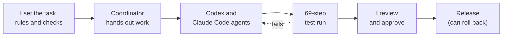

<picture>
  <source media="(prefers-color-scheme: dark)" srcset="assets/header-dark.svg">
  
</picture>

**[Portfolio](https://rekomakela.github.io/portfolio/en/)** · **[CV (PDF)](https://rekomakela.github.io/portfolio/en/cv/)** · **[Hintapiste.fi](https://hintapiste.fi)** · [LinkedIn](https://www.linkedin.com/in/reko-makela/) · reko.makela@gmail.com

I develop websites and digital services by combining search demand, analytics and what users need. I find what to improve, prioritise the work and build tools that turn findings into concrete actions.

I bring together business goals, data-driven decisions and hands-on technical delivery. I use automation and AI to speed up repetitive work and make development processes clearer.

## How the green squares get made

Most of my repos are private: employer work and third-party data. The commits in them are written by coding agents, under rules and checks I set:

## Projects

| Project | What it does | Type |
| --- | --- | --- |
| [**Hintapiste.fi**](https://rekomakela.github.io/portfolio/en/projects/hintatutka/) | Price comparison: 314,000+ products from 29 Finnish online shops, built by AI agents | Own product, live |
| [**Tools for steering agents**](https://rekomakela.github.io/portfolio/en/projects/autonomous-product-lab/) | Every agent step leaves a result to check; shows what a change touches and which tests cover it | Dev tool |
| [**Searchint**](https://rekomakela.github.io/portfolio/en/projects/searchint/) | Classifies search data for a large healthcare website, the same way every time, with sources | Work project |
| [**MCP Bridge**](https://rekomakela.github.io/portfolio/en/projects/mcp-bridge/) | Lets ChatGPT code on my Mac in allowed projects only; every action logged | Dev tool |
| [**Digital Sales expert agent**](https://rekomakela.github.io/portfolio/en/projects/copilot-studio-expert/) | Copilot Studio agent: answers from agreed knowledge, asks before changing work systems | Work project, in testing |
| [**Signum Decoder**](https://rekomakela.github.io/portfolio/en/projects/signum-decoder/) | AI reads an ad the way a semiotician does, every reading tied to what the ad shows | Experiment |

[All 12 projects →](https://rekomakela.github.io/portfolio/en/projects/)

## Career

<picture>
  <source media="(prefers-color-scheme: dark)" srcset="assets/timeline-dark.svg">
  
</picture>

Selected results at Terveystalo:

- **Copilot agents** for the task list and analytics, without a paid licence. Colleagues use the same instructions.
- **Tracking-link agent:** campaign codes from an approved list, now the team standard for internal links.
- **Search Console reports** that say what changed, why it matters and what to do next.
- **AI-use guidance** for external consultants, co-author: data handling, approved tools, agent access, human review.

## Skills

| Area | Tools |
| --- | --- |
| Digital sales, SEO and search demand | Search demand, content strategy, organic visibility |
| Conversion optimisation and user journeys | CRO, A/B tests, usability findings |
| Web analytics and reporting | Google Search Console, Piwik PRO, STAT, Semrush |
| Automation and technical prototyping | Python, pandas, JavaScript, HTML/CSS, Git/GitHub |
| AI-assisted workflows | ChatGPT, Claude, Gemini, Codex, prompt and context design |

Suomeksi: [portfolio ja CV](https://rekomakela.github.io/portfolio/)
