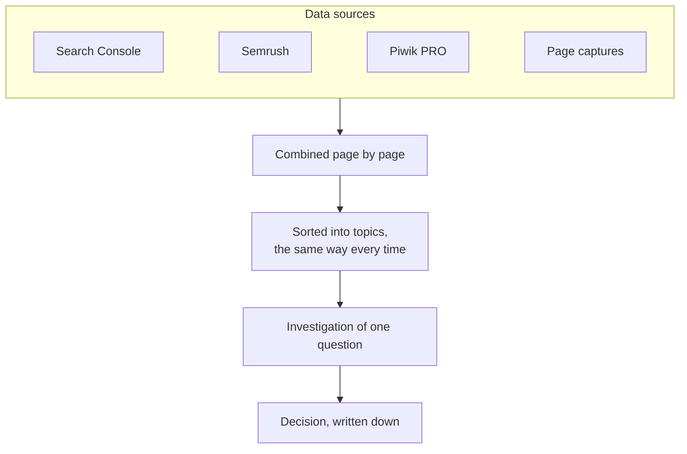
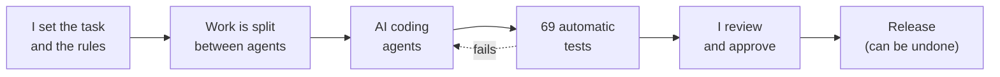

<picture>
  <source media="(prefers-color-scheme: dark)" srcset="assets/header-dark.svg">
  
</picture>

I make websites easier to find and easier to use. I work from search and analytics data, test changes, and build tools that take over the repetitive work.

**[Portfolio](https://rekomakela.github.io/portfolio/en/)** · **[CV (PDF)](https://rekomakela.github.io/portfolio/en/cv/)** · **[Hintapiste.fi](https://hintapiste.fi)** · [LinkedIn](https://www.linkedin.com/in/reko-makela/) · reko.makela@gmail.com

## Searchint: from search data to decisions

Tools I built for SEO, conversion and UX work on a large healthcare website. They bring search, analytics and page data together, so every finding can be traced back to its source.

- **Starts from a question:** a page, a search term or a medical specialty, not a data source.
- **Read-only:** none of its about 20 views can change the website.
- **Two parts:** [Searchint](https://rekomakela.github.io/portfolio/en/projects/searchint/) does the work; the [workbench](https://rekomakela.github.io/portfolio/en/projects/searchint-workbench/) is the app for using it.

Built at work. Described in general terms only; code and data stay private.

## Hintapiste.fi: search growth

<picture>
  <source media="(prefers-color-scheme: dark)" srcset="assets/growth-dark.svg">
  
</picture>

A Finnish price comparison site I run alone. AI agents write the code. In two months it went from zero to about 440 Google search appearances a day (Google Search Console, 12 Aug to 9 Oct 2026).

## Where the green squares come from

Most of my repositories are private production apps and internal tooling. AI coding agents write the commits; I set the rules and approve the result:

## Projects

| Project | What it does | Type |
| --- | --- | --- |
| [**Hintapiste.fi**](https://rekomakela.github.io/portfolio/en/projects/hintatutka/) | Compares prices of 314,000+ products from 29 Finnish online shops | Own product, live |
| [**Kaarat**](https://rekomakela.github.io/portfolio/en/projects/kaarat/) | Cars from many sellers in one place, matched to your needs, with risk checks | Own product |
| [**Searchint**](https://rekomakela.github.io/portfolio/en/projects/searchint/) + [**Workbench**](https://rekomakela.github.io/portfolio/en/projects/searchint-workbench/) | Search, analytics and page data in one place; findings end in written decisions | Work project |
| [**Customer language miner**](https://rekomakela.github.io/portfolio/en/projects/discussion-mining/) | What people say they need, from Finnish forums; every quote links to its source | Research tool |
| [**Signum**](https://github.com/rekomakela/signum-ads) | Explains what an ad is trying to make you believe: 89 ads decoded, based on Judith Williamson's _Decoding Advertisements_ (1978). [Browse the archive](https://rekomakela.github.io/signum-ads/) | Research tool |
| [**Airfare tracker**](https://rekomakela.github.io/portfolio/en/projects/public-data-intelligence/) | Collects and checks flight prices: 323,676 daily fares on 2,124 routes (July 2026) | Experiment |
| [**LocalRAG**](https://rekomakela.github.io/portfolio/en/projects/localrag/) | Ask questions about your own documents; nothing leaves your computer | Developer tool |
| [**Tools for steering agents**](https://rekomakela.github.io/portfolio/en/projects/autonomous-product-lab/) | Shows what an AI agent changed, what else it affects and which tests cover it | Developer tool |
| [**MCP Bridge**](https://rekomakela.github.io/portfolio/en/projects/mcp-bridge/) | Lets ChatGPT work on code on my Mac, only in projects I allow; every action is logged | Developer tool |
| [**ChatGPT plugins**](https://rekomakela.github.io/portfolio/en/projects/chatgpt-plugins/) | Ready-made workflows for ChatGPT: 22 skills for developing Hintapiste.fi, and a tool that compares purchases by price with delivery | Developer tool |

[All 13 projects →](https://rekomakela.github.io/portfolio/en/projects/)

## Career

<picture>
  <source media="(prefers-color-scheme: dark)" srcset="assets/timeline-dark.svg">
  
</picture>

Selected results at Terveystalo:

- **AI assistants for the team:** Copilot agents for task lists and analytics, without a paid licence. Colleagues use the same instructions.
- **Campaign links:** an agent that builds tracking codes from an approved list. It is now the team standard.
- **Search reports** that say what changed, why it matters and what to do next.
- **AI guidelines for consultants (co-author):** how to handle data, which tools are allowed, what agents may access, and when a person must review.

## Skills

| Area | What I use |
| --- | --- |
| SEO and search demand | Search demand, content strategy, organic visibility |
| Conversion and user journeys | A/B tests, usability findings |
| Analytics and reporting | Google Search Console, Piwik PRO, STAT, Semrush |
| Automation and prototypes | Python, pandas, JavaScript, HTML/CSS, Git |
| AI-assisted work | AI for content and SEO since 2021; OpenAI API since 2022; ChatGPT, Claude, Gemini, Codex |

Suomeksi: [portfolio ja CV](https://rekomakela.github.io/portfolio/)
