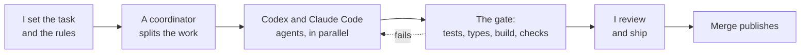

# Reko Mäkelä

Product designer and engineer who designs the service, builds it hands-on with AI agents and checks every change before it ships. Helsinki, Finland. Open to product designer and product engineer roles in AI-agent development, search and UX.

**[Case studies](https://agenticproductdesign.dev/projects/)** · **[How I build](https://agenticproductdesign.dev/how-i-build/)** · **[CV (PDF)](https://agenticproductdesign.dev/cv/reko-makela-cv-en.pdf)** · [About](https://agenticproductdesign.dev/about/) · [LinkedIn](https://www.linkedin.com/in/reko-makela/) · reko.makela@gmail.com

## Hintapiste.fi, built solo with AI agents

Since July 2026 a system of Codex and Claude Code agents has built [Hintapiste.fi](https://hintapiste.fi), a Finnish price comparison service, with me as the one person designing, building and shipping it: 1,100+ code changes between July and October 2026, every one through a 69-step gate before merge. I designed the multi-agent system (agents working in parallel, a coordinator handing out work, a scheduler keeping usage within limits), wrote the agents' working instructions and the shared task graph, set the quality bar and read the diffs before they merged.

The [replay](https://agenticproductdesign.dev/how-i-build/) shows one real stretch of that work, step by step, from a reviewed snapshot.

## Where the green squares come from

Most of my repositories are private: Hintapiste.fi, the tools around it and the research products below. AI coding agents write most of the commits; I design the service, build the system the agents work in, read the diffs and ship the result. The case studies are the public write-up; each carries its status and its evidence label, and every number on them has a source I can show.

## Projects

| Project | One line | Status |
| --- | --- | --- |
| [Hintapiste.fi](https://agenticproductdesign.dev/projects/hintatutka/) | Price comparison built solo with AI agents; 1,100+ code changes, July–October 2026 | Shipped |
| [Tools for steering agents](https://agenticproductdesign.dev/projects/autonomous-product-lab/) | Every step of agent work leaves a result you can check | Building |
| [Searchint](https://agenticproductdesign.dev/projects/searchint/) | Classifies search data automatically and shows the sources; 1,410 code changes, June–October 2026 | Building |
| [Searchint Workbench](https://agenticproductdesign.dev/projects/searchint-workbench/) | Search data, analytics and page findings side by side for a large healthcare website; about 20 read-only views | Building |
| [Digital sales expert agent](https://agenticproductdesign.dev/projects/copilot-studio-expert/) | Governed agent for a sales and marketing team; asks for approval before changing work systems; 13/13 automated tests passing | Building |
| [MCP Bridge](https://agenticproductdesign.dev/projects/mcp-bridge/) | ChatGPT codes on a local Mac in allowed projects only; 40+ tools, every action logged | Building |
| [ChatGPT plugins](https://agenticproductdesign.dev/projects/chatgpt-plugins/) | 39 skills across three plugins: Hintapiste development, SEO and UX, purchase comparison | Building |
| [Signum Decoder](https://github.com/rekomakela/signum-ads) | AI reads an ad the way a semiotician does; 89 decoded ads, [browse the archive](https://rekomakela.github.io/signum-ads/) | Building |
| [Kaarat](https://agenticproductdesign.dev/projects/kaarat/) | Cars from different sellers in one place, matched to your needs | Building |
| [Customer language from forums](https://agenticproductdesign.dev/projects/discussion-mining/) | People's own words from Finnish discussion forums for copy and content | Building |
| [Public data tracking](https://agenticproductdesign.dev/projects/public-data-intelligence/) | Procurement, research funding and airline fares; 323,676 daily fares across 2,124 routes | Building |
| [Search market analysis](https://agenticproductdesign.dev/projects/search-market-intelligence/) | Who shows up in search, for which searches, where the gaps are; about 100 competitors per site | Building |
| [LocalRAG](https://agenticproductdesign.dev/projects/localrag/) | Search and question your own documents without sending them outside | Building |
| [Solo Builder OS](https://agenticproductdesign.dev/projects/solo-builder-os/) | Operating model for a solo founder building with agents: phase gates, evidence classes, a validator | Shipped |
| [pdf2md](https://agenticproductdesign.dev/projects/pdf2md/) | PDF books to clean Markdown and context bundles for AI chats, locally | Building |
| [.fi domain finder](https://agenticproductdesign.dev/projects/fi-domain-finder/) | Free or soon-released .fi names, ranked by how natural the words are | Building |
| [Search intelligence layer](https://agenticproductdesign.dev/projects/search-intelligence-layer/) | Ranking data to a map of which sites compete on the same topics, with a blind evaluation | Paused |

[All 17 case studies →](https://agenticproductdesign.dev/projects/)

## Guides, methods and tools

Written from the projects above, for people doing the same work:

- **Building with agents:** [running agent work through gates](https://agenticproductdesign.dev/resources/agent-work-through-gates/), [governance rules for coding agents](https://agenticproductdesign.dev/resources/agent-governance-rules/), [evals for agent output](https://agenticproductdesign.dev/resources/evals-for-agent-output/)
- **Search intelligence:** [classifying search queries by topic](https://agenticproductdesign.dev/resources/search-query-classification/), [evidence separation rules for SEO data](https://agenticproductdesign.dev/resources/evidence-separation-for-seo-data/), [sizing and reading an A/B test](https://agenticproductdesign.dev/resources/ab-test-sizing-and-reading/)
- **Tools:** [snippet preview](https://agenticproductdesign.dev/tools/snippet-preview/), [query classifier](https://agenticproductdesign.dev/tools/query-classifier/), [A/B test calculator](https://agenticproductdesign.dev/tools/ab-test-calculator/), [expired-domain checklist](https://agenticproductdesign.dev/tools/expired-domain-checklist/)

[All resources →](https://agenticproductdesign.dev/resources/) · [All tools →](https://agenticproductdesign.dev/tools/)

## Topics

[Building products with AI agents](https://agenticproductdesign.dev/topics/ai-agents/) · [Search intelligence](https://agenticproductdesign.dev/topics/search-intelligence/) · [Finnish open data and consumer products](https://agenticproductdesign.dev/topics/finnish-data/) · [Local AI on Apple Silicon](https://agenticproductdesign.dev/topics/local-ai/) · [UX and content for large sites](https://agenticproductdesign.dev/topics/ux-content/)

## Experience

Employer work on service-page architecture, experimentation, analytics and AI enablement for a large healthcare website, described at capability level; before that, performance-based affiliate marketing and SEO consulting. Roles, results and sources: [experience](https://agenticproductdesign.dev/experience/) · [skills](https://agenticproductdesign.dev/about/) · [contact](https://agenticproductdesign.dev/contact/)
