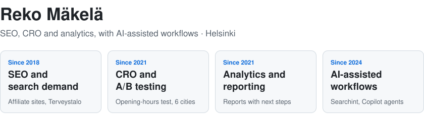
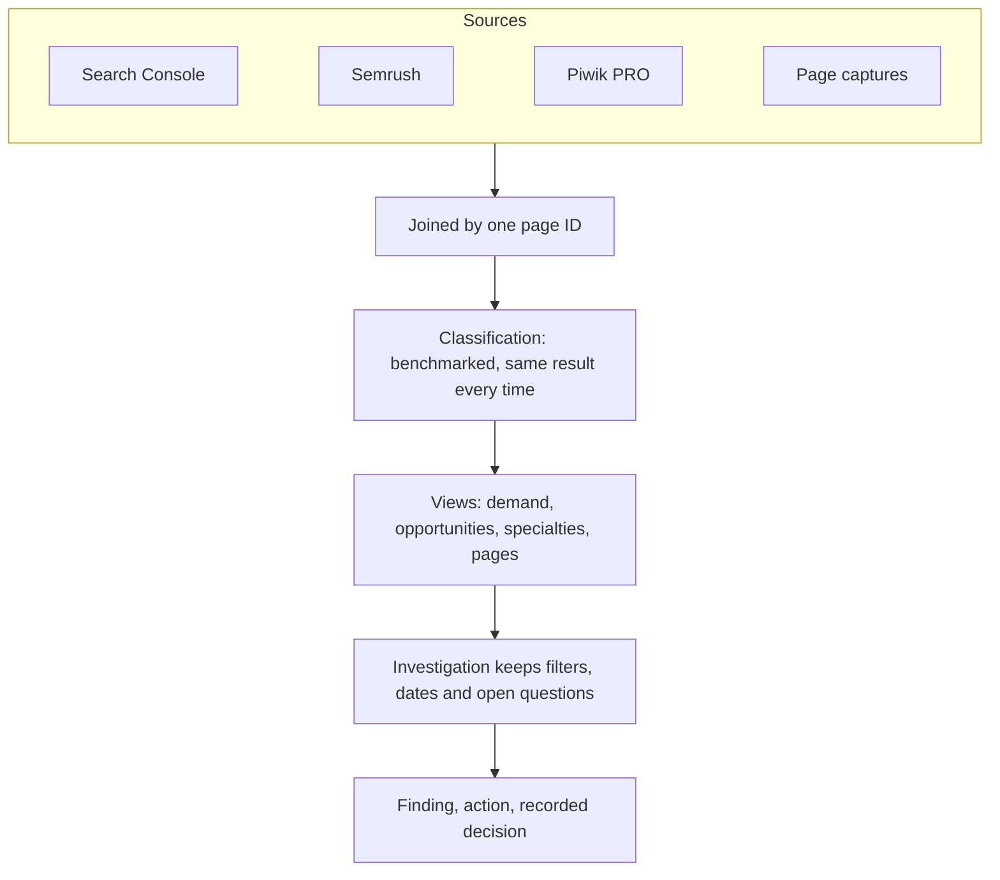
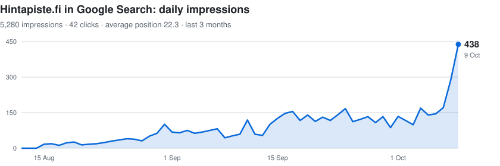
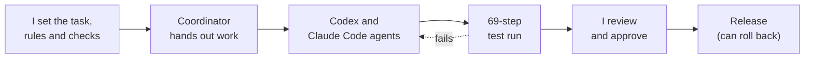
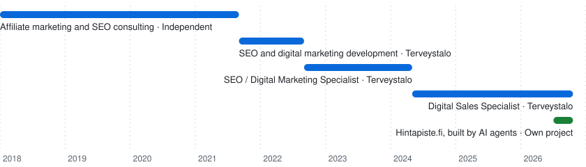

<picture>
  <source media="(prefers-color-scheme: dark)" srcset="assets/header-dark.svg">
  
</picture>

**[Portfolio](https://rekomakela.github.io/portfolio/en/)** · **[CV (PDF)](https://rekomakela.github.io/portfolio/en/cv/)** · **[Hintapiste.fi](https://hintapiste.fi)** · [LinkedIn](https://www.linkedin.com/in/reko-makela/) · reko.makela@gmail.com

I develop websites and digital services by combining search demand, analytics and what users need. I find what to improve, prioritise the work and build tools that turn findings into concrete actions.

I bring together business goals, data-driven decisions and hands-on technical delivery. I use automation and AI to speed up repetitive work and make development processes clearer.

## Searchint: from search data to decisions

Workflows I built for SEO, conversion and UX work on a large healthcare website. Every step can be traced back to its source, and the same data always gives the same result.

- **Organised by what you look into** (a page, search term, specialty or investigation), not by data source.
- **Read-only by design:** about 20 views, none of which can change the website or publish.
- **Runs with or without the UI:** the [workbench](https://rekomakela.github.io/portfolio/en/projects/searchint-workbench/) is its own app on top of [Searchint](https://rekomakela.github.io/portfolio/en/projects/searchint/).

Employer-related system, described in general terms only. Code and data stay private.

## Hintapiste.fi: search growth

<picture>
  <source media="(prefers-color-scheme: dark)" srcset="assets/growth-dark.svg">
  
</picture>

A Finnish price comparison site I run alone; AI agents write the code. In two months, its daily Google impressions went from zero to about 440. Source: Google Search Console, 12 Aug to 9 Oct 2026.

## How the green squares get made

Most of my repos are private: employer work and third-party data. The commits in them are written by coding agents, under rules and checks I set:

## Projects

| Project | What it does | Type |
| --- | --- | --- |
| [**Kaarat**](https://rekomakela.github.io/portfolio/en/projects/kaarat/) | Cars from many sellers in one place, matched to your needs, with risk checks | Own product |
| [**Customer language miner**](https://rekomakela.github.io/portfolio/en/projects/discussion-mining/) | People's own words and needs from Finnish forums, every quote traced to its source | Research tool |
| [**LocalRAG**](https://rekomakela.github.io/portfolio/en/projects/localrag/) | Search and question your own documents; local models, nothing leaves the machine | Dev tool |
| [**Airfare tracker**](https://rekomakela.github.io/portfolio/en/projects/public-data-intelligence/) | Flight prices collected and checked: 323,676 daily fares across 2,124 routes (July 2026) | Experiment |
| [**Searchint**](https://rekomakela.github.io/portfolio/en/projects/searchint/) + [**Workbench**](https://rekomakela.github.io/portfolio/en/projects/searchint-workbench/) | Search, analytics and page data joined into investigations that end in recorded decisions | Work project |
| [**Hintapiste.fi**](https://rekomakela.github.io/portfolio/en/projects/hintatutka/) | Price comparison: 314,000+ products from 29 Finnish online shops, built by AI agents | Own product, live |
| [**Tools for steering agents**](https://rekomakela.github.io/portfolio/en/projects/autonomous-product-lab/) | Every agent step leaves a result to check; shows what a change touches and which tests cover it | Dev tool |
| [**MCP Bridge**](https://rekomakela.github.io/portfolio/en/projects/mcp-bridge/) | Lets ChatGPT code on my Mac in allowed projects only; every action logged | Dev tool |
| [**Signum**](https://github.com/rekomakela/signum-ads) | Reads ads the way Judith Williamson did in _Decoding Advertisements_ (1978), with a local vision model: 89 ads decoded, every claim tied to what you can see. [Browse the archive](https://rekomakela.github.io/signum-ads/) | Research tool |

[All 12 projects →](https://rekomakela.github.io/portfolio/en/projects/)

## Career

<picture>
  <source media="(prefers-color-scheme: dark)" srcset="assets/timeline-dark.svg">
  
</picture>

Selected results at Terveystalo:

- **Copilot agents** for the task list and analytics, without a paid licence. Colleagues use the same instructions.
- **Tracking-link agent:** campaign codes from an approved list, now the team standard for internal links.
- **Search Console reports** that say what changed, why it matters and what to do next.
- **AI-use guidance** for external consultants, co-author: data handling, approved tools, agent access, human review.

## Skills

| Area | Tools |
| --- | --- |
| Digital sales, SEO and search demand | Search demand, content strategy, organic visibility |
| Conversion optimisation and user journeys | CRO, A/B tests, usability findings |
| Web analytics and reporting | Google Search Console, Piwik PRO, STAT, Semrush |
| Automation and technical prototyping | Python, pandas, JavaScript, HTML/CSS, Git/GitHub |
| AI-assisted workflows (since 2021) | Generative AI for content and SEO since 2021 (Frase AI Writer beta tester, Jarvis/Jasper); OpenAI API since 2022 (Codex beta, GPT-4 API 2023); ChatGPT, Claude, Gemini, Codex, prompt and context design |

Suomeksi: [portfolio ja CV](https://rekomakela.github.io/portfolio/)
